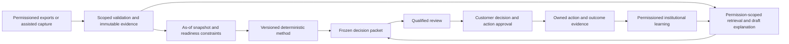

# GridMind 3.1 — Manufacturer Resolution System / Product Architecture

> **Latest manufacturing direction — 20 October 2026:** [§11](#11-india-first-manufacturing-intelligence-requirements-20-october-2026) specifies India-first feasibility, bottleneck investigation and delivery risk under G31-C20-09. The Master Plan owns capability gates. Earlier priority/route examples below are historical where superseded. This is a specification amendment; no manufacturing engine or autonomy is implemented.

> **Current authority — 20 October 2026:** [Master Plan §7](../gridmind-master-plan-2026-10-11.md) and [G31-C20-01–08](../gridmind-decision-constitution-and-contradiction-register-2026-10-10.md#canonical-consolidation-decisions-20-october-2026) supersede older priorities, calendar targets, route/status statements and M1-only queues here. No number-one commercial opportunity is approved; the premature quality-loss ranking is withdrawn. Preserve earlier technical evidence, synthetic-build authorizations and release safeguards. Current routes are public `/` and application `/dashboard`; #136/#149/#153 are merged. #154/#156/#158/#160/#162 remain drafts; #150 is open/behind main at this audit. This document is supporting guidance, not another plan.

**Implementation/release-status correction, 18 October 2026:** PR #140 (industrial intelligence research), PR #142 (synthetic Resolve triage) and PR #136 (strategy-document integration) were merged, without enabling a real R1/R2/R3 professional engine, production case storage or any live bill calculator. Later detailed examples remain design proposals unless checked against the current `src/` and Supabase schema. The [Decision Constitution](../gridmind-decision-constitution-and-contradiction-register-2026-10-10.md) controls final status.

**Date:** 17 October 2026 · **Class:** Supporting product and solution architecture, **not an implementation claim**, separate roadmap, new brand, or authorization to ship. The user's term “SOAP plan” is interpreted here as a comprehensive **Service–Operations–Architecture–Payments** operating design (a working shorthand, not the SOAP XML network protocol). “Redmind” has not been approved as a GridMind brand rename.  
**Strategic authority:** [sole Master Plan](../gridmind-master-plan-2026-10-11.md), [Decision Constitution](../gridmind-decision-constitution-and-contradiction-register-2026-10-10.md), [sole Buyer Discovery Sprint](../gridmind-buyer-discovery-sprint-2026-10-11.md). Read [100-problem Research Atlas](../research/gridmind-100-manufacturing-problem-opportunity-atlas-2026-10-17.md) as testable taxonomy, and [Commercial & Payment SOP](../operations/gridmind-3-1-service-sop-commercial-and-payment-blueprint-2026-10-17.md) for future business operations.

## 1. Customer job to be done and product promise

Manufacturers rarely lack data or software altogether. They may lack a trusted and timely **cross-functional resolution of a costly exception** when sources conflict, cause is uncertain, economic consequences are disputed, and responsibility is fragmented. GridMind proposes to reduce time-to-_defensible decision_, not claim magical operational diagnosis or substitute for an established ERP, QMS, CMMS, accountant, approved energy auditor, safety professional, counsel or payment processor.

**North-star case:** “What happened? What sources can actually prove? What remains unknown? Which domain expert must decide? Who owns the customer-approved action? Did follow-up evidence demonstrate the intended outcome?” This is an outcome hypothesis, not a validated customer claim.

**Scope tiers:** 100 **recognized problem hypotheses** (10 categories) → three R1/R2/R3 discovery interviews → **one** validated paid method → conditionally reusable platform components → future specializations after proof. Do not build 100 engines.

## 2. Users and purchasing circumstances

| Role                           | Need                                                       | Allowed UI/rights                                                                          |
| ------------------------------ | ---------------------------------------------------------- | ------------------------------------------------------------------------------------------ |
| Anonymous industrial visitor   | Understand credible scope and limitations                  | Public /website, fictional example, non-confidential contact only                          |
| Factory owner / economic buyer | Case economics, decisions, delivery status                 | Own authorized cases and released briefs; no internal reviewer dissent/pricing internals   |
| Quality or production champion | Historical failure/inspection/corrective-action links      | Scoped factory/case evidence and approved assigned actions                                 |
| Commercial/accounts sponsor    | Acceptance/invoice documentary blockers                    | Authorized R2 case scope only; no access to unrelated payroll, treasury or client payments |
| Plant energy sponsor           | Contract/bill anomaly review                               | R3 scoped tariff/bill evidence after permission and qualified review                       |
| GridMind investigator          | Observations, questions, source quality and draft findings | Only assigned, permissioned cases; cannot independently certify own findings               |
| Independent qualified reviewer | Frozen revision and competence-limited judgment            | Assigned source/revision; deny publish or technical signoff beyond scope                   |
| GridMind manager / finance     | Customer deliverables, workload and GridMind invoices      | Need-to-know permissions; billing ledger separate from technical sources                   |
| Administrator / DevOps         | Identity, availability, incident response and migrations   | No routine entitlement to customer trade secrets based merely on admin access              |

**Authorization:** authenticated principal × organization × factory × case assignment × role × source purpose/consent × frozen revision; server-side checks and RLS both required. UI-hidden controls are NOT security.

## 3. The seven logical product modules

1. **Public narrative and research contact** — source: existing Lovable-connected `/website`. Signature brand green `#9ADD00` preserved, compelling motion with accessibility/reduced-motion, fictional case demo, honest status, actual non-confidential recipient and privacy/consent. No checkout; root `/` retains current dashboard until separately tested root migration.
2. **Resolve case workbench** — case question and owner; R1/R2/R3 as _candidate tags_; intake scope, state and evidence requests; no automated diagnosis solely by candidate name.
3. **Evidence/provenance layer** — signed scope, permitted sources, immutable/versioned documents or references, checksum, origin, collection method, event time, timezone, units, contradicting evidence and retention. Closed by default without customer data custody clearance.
4. **Observation and hypothesis engine** — deterministic parsers and calculations per **chosen/verified** method; source-to-claim links; missingness/uncertainty labels; unresolved competing explanations. Generative AI may summarize permitted text or propose _questions_, not make technical fact claims without source/reviewer.
5. **Human review and resolution workflow** — qualified reviewer assignment, frozen-revision signoff/rejection, dissent, customer-approved action, action owner, reminders and effectiveness check. No synthetic simulation masquerading as a real signature.
6. **Customer, team and economics views** — released briefs, next decisions, outcomes; internal case queue, contributor work/costs, client delivery status, _GridMind's own_ billing status via authorized finance workflow. No cross-tenant cost exposure.
7. **Future integration adapters** — read-only and consented ERP/QMS/accounting exports, specialist test results and, _only if needed and safe_, process telemetry. No factory controller, OT command, autonomous maintenance, payment custody or cross-supplier pooled access.

**Architecture rule:** modules 2–5 are a shared **case core**. Domain “methods” are separately reviewed plugins with proof of specialized requirements; vendor integrations should be adapters, not the center of the product.

## 4. Canonical objects and proof obligations (schema proposal, NOT migration DDL)

| Object                                                 | Must capture                                                           | Core invariant                                                 |
| ------------------------------------------------------ | ---------------------------------------------------------------------- | -------------------------------------------------------------- |
| `Organization`, `Factory`, `CaseGrant`                 | legal/customer organization, factory scope, role/assignment            | cross-tenant deny, least privilege                             |
| `OpportunityCandidate`                                 | ID R1/R2/R3, evidence _status_, not promise                            | speculative catalogue is not paid service                      |
| `InvestigationCase`                                    | bounded question, event/window, scope, owner, lifecycle                | case not proof of cause/value                                  |
| `ConsentScope`                                         | authority, purpose, sources, allowed processing, withdrawal, expiry    | no source processing outside accepted scope                    |
| `EvidenceSource` / `EvidenceRevision`                  | checksum, chain of custody, origin, timestamps, permissions            | immutable referenced revision; real data gated                 |
| `Observation`                                          | exact source and transformation, unit, uncertainty, status             | not diagnosis or “verified savings”                            |
| `Hypothesis`                                           | supporting and disconfirming observations, unanswered tests            | cannot silently be promoted into observation                   |
| `ReviewDecision`                                       | professional competence, revision hash, reviewer/independence, dissent | own work cannot self-certify where independent review required |
| `ResolutionBrief`                                      | fact vs unknown vs alternative; approved customer projection           | no release on stale/failing review                             |
| `CustomerDecision` & `ActionTask`                      | customer approver, permitted recommendation, owner, due date           | action is not autonomous plant control                         |
| `OutcomeAssessment`                                    | comparator, baseline, timeframe, counterfactual limitations, costs     | estimate and verified realized improvement remain distinct     |
| `ServiceAgreement` / `BillingInvoice` / `PaymentEvent` | lawful GridMind fee terms, settlement and accounting trace             | isolated from factory receivables; no live payment now         |
| `AuditEvent`                                           | actor/time/purpose/decision/revision                                   | append-only, no retroactive invisible rewrite                  |

Case state model (proposed): **request → fit screened → commercial/legal scope accepted → evidence authorized → evidence incomplete/ready → investigator draft → qualified review pending/approved/rejected → customer decision pending/recorded → follow-up → outcome verified / inconclusive / referred / closed.** Deny skipping authorization; evidence revision after review invalidates dependent approvals; customer decision is separate from reviewer opinion; closed never automatically means savings.

## 5. Domain method contracts — not just enum expansion

**R1/C2 quality + directly related C1 production:**

- Input candidates: customer rejection notice, part revision, batch/lot, approved inspection summaries, relevant production/shift incidents, prior CAPA and verifiable action windows; do not require unrelated employee personal data.
- Computation: chronology, repeat-event comparison, missing source checklist, scrapped/reworked units × **documented incremental cost assumptions**; optional SPC/MSA only by qualified method.
- Output: quality evidence brief and method-specific uncertainties; qualified review aligned with existing APQP/PPAP/FMEA/8D practices when appropriate. **Not** automatic PPAP/quality certification or root-cause guarantee.

**R2/C6 acceptance and invoice documentary exception:**

- Input candidates: PO/version, dispatch, delivery confirmation, acceptance notice, quality claim, agreed deduction basis, invoiced amount, credit note, owner-authorized correspondence.
- Computation: expected versus observed dates/quantities, document consistency, open acceptance steps and commercial signoff; never treat full outstanding receivable as GridMind impact.
- Output: documentation gap map, action owner, response pack. No legal representation, financing, payment processing or promise to collect an invoice.

**R3/C4 electricity bill/contract exposure:**

- Input candidates: disclosed tariff class and contract, permitted electricity bill periods, demand/power-factor line items, change dates, optionally production context.
- Computation: transparent line-item comparisons, anomaly screening, explicit tariff-version uncertainty and confounders.
- Output: reviewer-ready anomaly and clarification report. No physical audit, unsafe electrical testing, energy savings warranty or grid control.

**C3/C5 and remaining 94 themes:** taxonomy tags or contributing evidence as needed, not customer-released automatic methods. Add a method only after buyer, rights, expert cost, acceptance fixture and safety gates.

## 6. On-site first but software-enabled

The initial product is a _service operating system_, where an authorized trained professional can investigate with permission and the customer retains decisions. Start with manual or spreadsheet/CSV-scope evidence mapping on synthetic test cases; do not depend on installation of 20 sensors, new edge hardware, ERP replatforming or telemetry just to discuss a recent quality/invoice exception.

**Illustrative historical case journey**: manufacturing owner discusses rejected components without revealing secrets → scoped fit check → accepted expert-led investigation contract → approved source custody → analyst compiles rejection chronology and contradictory inspection documents → reviewer rejects/accepts specific interpretation → owner authorizes proposed corrective action → follow-up observed → outcome typed verified/inconclusive. If rights or specialist are unavailable, record refusal/referral, not fabricated certainty.

## 7. Present source and routes — do not overclaim

Existing main software: **TanStack Start, React, Vite, Bun, Lovable, Supabase** with a synthetic C1/C4 investigation/analysis history and reviewable client/team screens. The **fictional non-persistent R1/R2/R3 triage** was integrated via merged PR #142, and the GridMind 3.1 documentation consolidation was merged via PR #136. The broader proposed public marketing copy is **not** shipped; [#138](https://github.com/vartmaansharma-blip/gridmind-insights-ea7a9796/issues/138) remains its separate acceptance gate. No connected qualified R1/R2 engine or production customer-data release is established.

**Route preservation:** `/website` public; `/` existing dashboard; `/investigations` fictional discovery/synthetic path; `/cases` authorized customer-facing sample; `/team/intake` and `/team/cases` staff routes. PR #132 proposes a different public-root/onboarding route, but is held separately until exact route, auth, RLS and browser acceptance.

**Deployment/security:** [pre-merge decision packet](../engineering/gridmind-3-1-pre-merge-decision-packet-2026-10-17.md), issue #130 production migration drift and issue #29 populated tenant/authenticated checks remain binding. The same public repo must not contain real factory records; server credentials may not be placed in the browser. No production Supabase mutation from this doc.

## 8. User experience acceptance (fictional case)

| Screen                  | Answers for the user                                 | Required safety/accessibility behaviors                                                                                       |
| ----------------------- | ---------------------------------------------------- | ----------------------------------------------------------------------------------------------------------------------------- |
| Public hero             | “What is GridMind and why might I trust its method?” | honest early-stage claims, #9ADD00 signature green, readable mobile contrast, reduced-motion, functional non-confidential CTA |
| Fictional case timeline | “What happened and how do documents connect?”        | prominent fictional banner, provenance graph, unknown states, no false customer endorsement                                   |
| Case overview           | “What is unresolved and who can decide?”             | owner, priority, permission scope, next review, reviewer status, clear timeline                                               |
| Evidence view           | “Can I verify the source of this finding?”           | revision/hash/source/timestamp, no unauthorized downloads or cross-tenant visibility                                          |
| Investigator panel      | “What is observed vs hypothesized?”                  | unresolved contradiction, test/absence, no diagnosis generated from monthly bills                                             |
| Reviewer panel          | “Which frozen version am I signing?”                 | competence and independent assignment; reject/require more evidence                                                           |
| Customer brief          | “What action is recommended and why?”                | released facts/options, explicit bounds and approver action                                                                   |
| Outcome view            | “Did it actually help?”                              | baseline, timing, confounders, measured versus estimated/unknown                                                              |
| Finance view            | “What did GridMind bill and collect?”                | own fee ledger separate from client AR; no live payment integration initially                                                 |

## 9. Test matrix and domain gates

**Synthetic acceptance now:** fictional 10-category selection does not create 100 methods; invalid/missing scope rejected; tenant-role request cannot access other factory; stale reviewer approval invalidated by revision; no automatic “root cause” or “savings”; rejected evidence displayed as unknown; contact only non-confidential; reduced-motion and keyboard path function. Existing C1/C4 tests remain intact.

**Conditional customer/production acceptance:** independently reviewed migrations and populated two-tenant auth, data agreement, source custody, security logs, reviewer competence, customer approval and legally authorized operating arrangement; real case handled retrospectively under named oversight; no equipment control. A passing CI/build or green Vercel deployment is not customer-ready.

**Commercial acceptance:** actual recent customer pain, paid next step, reviewed real economics and repeat need from buyer tracker; no use of fictional invoice as proof of cash recovery.

## 9A. Industrial intelligence competitor learning — product-contract addendum (18 Oct 2026)

**Primary mapping:** [competitor learning register](../research/gridmind-industrial-intelligence-competitor-learnings-2026-10-18.md) CL-01–CL-12. These principles refine acceptance, not authorize implementation. [R3 tariff/bill screening method and twelve negative fixtures](gridmind-r3-electricity-screening-method-and-test-fixtures-2026-10-18.md) is the proposed first research method **subject to professional approval**.

- **Source-first search (CADDi lesson):** source, owner, collection purpose, company/site, date/effective period, revision, original units and permission precede synthesis. No source or conflicting sources → explain why inconclusive.
- **Insight-to-execution (Arch lesson):** every case has a named reviewer, customer approver, authorized action owner, follow-up observation window, and verified / unverified / inconclusive classification. A report or closed task is not automatically verified value.
- **Shared core, bounded domain methods (Noetive lesson):** R1 quality, R2 acceptance/invoice, R3 billing have independently reviewed required sources/calculations; a common enum is NOT enough. R3 first in discovery only; R2 comparator remains mandatory.
- **Deterministic-before-generative (Siemens lesson):** tariff bill arithmetic uses date-specific professional rules and typed units. AI cannot fill missing parameters or invent a savings forecast; one state must be “need qualified review.”
- **Future topology and physical constraints (Neara/GE lesson):** note architectural possibility for future approved infrastructure models; no network graph, simulation or OT-control implementation in current MVP.
- **Adapt rather than replace (incumbents):** prefer read-only/manual authorized records and exported CSV; integration is conditional on actual buyer need and independently tested security.
- **Acceptance:** synthetic correct/invalid/inconclusive/adversarial cases, reviewer revision integrity, tenant negative checks; no claims of working real R1/R2/R3 technical engine or live professional services from spec edits alone.

## 10. How expansion earns permission

For each additional domain method require: (i) more than an attractive opportunity score—actual buyer access and specific repeated pain; (ii) independent expert/method owner; (iii) minimum auditable sources and permission model; (iv) valid test fixtures and negative controls; (v) priced delivery with collected cash and sustainable contribution; (vi) release approval and reversal plan. The fact that two domains share a table does not mean their regulated actions share an approval.

**Out-of-scope unless separately validated/authorized:** full ERP/QMS/CMMS, supplier marketplace, autonomous plant controller, OT cyber penetration testing, regulated receivables finance, lawyer/certifier substitution, digital payment aggregation, grid/BESS dispatch or a universal AI agent.

**Research/competitor references:** [AIAG Quality Core Tools](https://www.aiag.org/expertise-areas/quality/quality-core-tools), [NIST MEP Supply Chain](https://www.nist.gov/mep/supply-chain), [Odoo Quality](https://www.odoo.com/app/quality-features), [Zoho Books](https://www.zoho.com/in/books/pricing/), [BEE MSME energy programmes](https://saathee.beeindia.gov.in/sme-programme/). Existing providers' products are real; GridMind's superiority remains unproven.

## 11. India-first manufacturing-intelligence requirements — 20 October 2026

**Owner:** founder/product; independent industrial reviewer required for method approval. **Status:** first-principles specification, not implemented capability, measured accuracy, customer validation or schema authorization. [G31-C20-09](../gridmind-decision-constitution-and-contradiction-register-2026-10-10.md#manufacturing-intelligence-direction-20-october-2026) governs this amendment; [Master Plan §7](../gridmind-master-plan-2026-10-11.md#7-dependency-based-execution-order) is the sole capability roadmap. Where earlier sections prescribe R3-first priority or root-dashboard behavior, current canonical authority governs. Existing source and experiments remain reusable.

### 11.1 First principles and bounded customer job

A delivered order requires the right specification, accepted material, feasible operation sequence, available qualified people/equipment/tooling, sufficient capacity, quality release, external processing and dispatch capacity before the committed date. A failure in any required dependency can dominate delivery even when average machine utilization is low. Adding robots cannot by itself supply missing material, qualify a tool, finance inventory or obtain customer approval. These are causal reasoning constraints, not a diagnosis of the reported factory.

**Product hypothesis:** for one component part family and one order, help the owner/planner determine what is feasible under stated assumptions, which constraint currently prevents commitment, what is unknown, what decisions remain possible and who must decide by when. “Bottleneck diagnosis” initially means an evidence-backed constraint investigation; it does not assert root cause, optimal scheduling or automatic machine diagnosis. The unit of value is a better timely decision, not an AI answer or dashboard visit.

**Initial scope:** Indian component contract manufacturers; Jamshedpur–Adityapur provides the first learning/access context. Study stamping/fabrication, CNC and casting/forging independently. Do not use one segment's cycle-time, yield, inspection or tooling assumptions in another. Select the first actual part/process only after owner confirmation. One reported account, 20 machines or utilization near 50% does not identify that process or its binding constraint.

**Actors and decisions:** owner/commercial approver accepts a customer promise or cost; planner owns the schedule; production lead confirms capacity/route; procurement confirms material/outsourcing; quality lead controls acceptance/hold/release; investigator prepares the packet; a competent reviewer challenges method and findings. These may be the same employee in a small firm, but independent method/security approval cannot be fabricated by assigning another role to that person. Customer commitment, quality disposition and professional review remain distinct decisions.

**Excluded from the first release:** an ERP/MES replacement, live plant integration, broad CAD understanding, a generalized plant-head agent, autonomous procurement, quality release, payment/credit decisions, OT control or a numeric on-time probability. Preserve existing energy/electricity, equipment catalogue, compressed air, case workflow and public design as capabilities with their own current gates.

### 11.2 Requirements and falsification

| ID                                 | Required behavior                                                                                                                                                                                                                                                                     | Acceptance evidence / adverse case                                                                                                                                                                                           |
| ---------------------------------- | ------------------------------------------------------------------------------------------------------------------------------------------------------------------------------------------------------------------------------------------------------------------------------------- | ---------------------------------------------------------------------------------------------------------------------------------------------------------------------------------------------------------------------------- |
| **MF-01 Scope and decision**       | Bind organization/factory, part/drawing revision, order revision, quantity/UOM, due date/timezone, quality requirements, decision owner and as-of time. Distinguish requested, promised and revised due dates.                                                                        | No ambiguous “Friday,” mixed revisions or silent quantity conversion. Missing decisive scope returns incomplete.                                                                                                             |
| **MF-02 Minimum evidence**         | Accept only permitted records; preserve original bytes, digest, source location, collection/event/known-at timestamps, units and transformation lineage. Begin with assisted records/exports after rights gates, no mandatory sensors.                                                | Missing source, uncertain identity/units or conflicting stock records are explicit; a checksum does not authenticate a supplier or establish permission.                                                                     |
| **MF-03 Readiness**                | Show material grade/quantity/availability, released drawing, route, tooling/fixture state, skill/shift, machine/calendar reservations, quality and subcontractor/dispatch prerequisites. Each is confirmed, blocked, unknown, stale, conflicting or not applicable with reason/owner. | Absence is unknown, never ready/zero. A confirmed stock balance is not freely allocatable stock. Critical unknown blocks a favorable commitment conclusion.                                                                  |
| **MF-04 Feasibility bounds**       | Display an assumption-bound earliest/likely range only under a reviewed method; account for route precedence, setups, batch/transfer rules, reservations, calendars, yield and rework uncertainty.                                                                                    | No claim that average utilization equals available capacity; no free overtime, unapproved substitution or capacity double allocation. Unsupported inputs withhold dates.                                                     |
| **MF-05 Constraint investigation** | Separate material shortage, physical capacity, quality hold, tooling, skills, finance, supplier and information/approval delay. Trace each alleged blocker to evidence and possible disconfirmation.                                                                                  | No inference that expensive grinding is avoidable rework or that high queue length proves machine failure. Multiple blockers may remain unresolved.                                                                          |
| **MF-06 Delivery risk**            | Explain constraint, affected order/operation, impact range, decision window, urgency, uncertainty and next check. Keep severity separate from evidence confidence.                                                                                                                    | No uncalibrated “87% late.” No probability or guaranteed recovery from a single historical case.                                                                                                                             |
| **MF-07 Scenarios**                | Compare hold/clarify, approved resequencing, authorized alternative sourcing, separately reviewed subcontracting/overtime, or renegotiating the date, including costs and displaced orders.                                                                                           | Alternatives remain drafts; cannot bypass specs, safety, labor rules, qualification, contracts or quality release. No fictitious supplier availability.                                                                      |
| **MF-08 Human decision**           | Freeze evidence, assumptions, method and recommendation revisions for review; bind separate customer approval to the exact intended action. Record dissent and refusal.                                                                                                               | Changed source, payload, scope, expiry or revoked grant invalidates dependent approval. Simulation cannot become a signature.                                                                                                |
| **MF-09 Replay and comparison**    | Reconstruct only what was knowable at each checkpoint; compare with competent current process under identical information/time budgets.                                                                                                                                               | Later supplier acknowledgment cannot retrospectively appear in an earlier recommendation. Include an unactionable shortage and a case current ERP already resolves.                                                          |
| **MF-10 Learning and outcome**     | Retain permissioned decision rationale, action and follow-up with outcome class measured/estimated/inconclusive, counterfactual limits and correction history.                                                                                                                        | Completed tasks and descriptive differences are not verified savings. No cross-customer training/knowledge reuse without separate rights.                                                                                    |
| **MF-11 Operator experience**      | One concise decision packet: order, constraints/unknowns, source drilldown, options, owner/deadline and review status. Reuse existing green components and routes in any later UI adapter.                                                                                            | Keyboard/mobile, visible unknown/error/stale states and reduced motion; labels distinguish synthetic case and simulated reviewer. Translation requires validated terminology and preserves original text.                    |
| **MF-12 Operational limits**       | Bound input size, parser time, processing spend and retention; support assisted capture and interrupted connectivity with explicit sync state after separately reviewed design.                                                                                                       | Proposed initial acceptance target: 100 operation/constraint records and a deterministic offline replay in five seconds on a recorded reference machine; benchmark not yet run. No unsecured local cache of factory records. |

**Method sketch for reviewer discussion:** for operation i, candidate required machine-minutes = setup-minutes + process-attempts × minutes/attempt. Converting good quantity to attempts using quantity/yield is an assumption that requires a valid yield definition, period and uncertainty. Availability means eligible calendar capacity less accepted reservations and planned unavailability; machine-minutes and person-minutes remain distinct. Earliest start must respect predecessor release, material readiness, eligible resource slot and all critical prerequisites. Dispatch includes inspection/release, external process and transit cutoffs. A hand calculation or optimization result is conditional on input truth and model scope; this document supplies no scheduler.

Report utilization with denominator, period, good/total output and exclusions. Report delivery-risk lead time relative to the last **feasible** authorized action deadline; an early alert after the useful window is not useful prevention. Evaluate alternative actions against all affected orders, cost, quality and safety. The largest queue, lowest utilization, highest cost and binding capacity constraint are different concepts. Missing or contradictory decisive inputs yield inconclusive, with a targeted evidence request. Root cause and verified savings remain null until separately established by a qualified method and outcome evidence.

### 11.3 Initial logical data model — proposal, no DDL

Reuse existing tenant/factory/asset and investigation identities, evidence/revision, finding, review, decision, action and outcome contracts. `src/lib/gridmind/domain.ts` supplies bounded observation/context contracts; `src/lib/investigation/schema.ts` and related case files supply investigation objects; the Resolve demo schema explicitly supports only synthetic workflow. Their existence does not prove that new entities are persisted or production deployed. Preserve existing C/R enums; do not rename C1/C4 to activate manufacturing.

| Logical object                                     | Minimum fields / relationships                                                                                                                                  | Invariant                                                                                                                                                  |
| -------------------------------------------------- | --------------------------------------------------------------------------------------------------------------------------------------------------------------- | ---------------------------------------------------------------------------------------------------------------------------------------------------------- |
| `PartRevision`                                     | scoped external part ID, drawing/spec revision and permitted source reference, UOM, effective interval                                                          | Revision identity is explicit; confidential drawings stay outside public Git. No generative change to requirements.                                        |
| `OrderRevision`                                    | existing case ID, part revision, quantity/UOM, requested/promised due timestamps, priority source, dispatch terms and revision predecessor                      | New promises append a revision; changed due dates do not erase past lateness.                                                                              |
| `RouteRevision` / `OperationRequirement`           | part/order scope, operation IDs, predecessor IDs, setup/run units and ranges, eligible resource/skill/tool and quality gates, batch/transfer assumptions        | Acyclic validated precedence; no unsupported linear-route assumption or hidden loss factor.                                                                |
| `ResourceCalendarRevision` / `CapacityReservation` | existing asset/team-role reference, eligible interval, capacity unit, maintenance/shift state, existing order allocation and source                             | Scope/unit match; no double booking; unnamed workers or private personnel data minimized. No machine-control identity.                                     |
| `MaterialAvailabilityRevision`                     | grade/spec, lot/quantity/UOM, allocated quantity, quality status, location, expected arrival range, supplier source                                             | Quarantined/reserved/ordered stock is not accepted available stock; ETA is an estimate.                                                                    |
| `ReadinessConstraint`                              | order/operation scope, kind, required quantity/time/state, status, evidence references, owner, check deadline, last confirmed time, expiry                      | Confirmed/blocked/unknown/stale/conflicting/not-applicable are distinct. Not-applicable needs a reason and reviewer.                                       |
| `EvidenceRevision`                                 | exact digest, source pointer/line/page/JSON pointer, origin, event time, known-at and ingested-at, timezone/clock status, permission purpose/expiry and custody | Immutable bytes and transformation lineage; known-at preserves historical availability; permissions are server-verified grants, not a boolean from a file. |
| `FeasibilityAssessmentRevision`                    | case/order/route/calendar versions, frozen input digest, method/version, as-of time, conditions, missingness, affected orders, range/unknown result             | Reproducible output; no asserted feasible date on unresolved decisive inputs.                                                                              |
| `Scenario` / `DecisionOption`                      | assessment reference, changed assumptions, authorized eligibility, cost bounds, displaced orders, risks, review state                                           | Scenario is hypothetical; cannot change inventory/schedule/promises.                                                                                       |
| Existing `Review` / `CustomerDecision` / `Action`  | competence, independence/conflicts, actor/grant, exact input/output/action digests, expiry, limits, status, idempotency and recovery reference                  | Approval by authorized human; revision or scope change invalidates dependent authorization; no self-approval by AI.                                        |
| Existing `Outcome` / permissioned `KnowledgeEntry` | baseline, actual dates/quality/cost, comparator, confounders, assessment/review links, applicability limits and retention                                       | Learning remains tenant/purpose bounded and correctable. No automatic cross-factory inference or causal benefit.                                           |

Every persisted row/reference would carry organization/factory/case scope where applicable; external IDs are namespaced, never authorization tokens. Validate foreign scope on every link. Record event time separately from known-at time (when a participant could use the information) and system ingestion time; a retroactively entered fact cannot gain an earlier knowledge timestamp without auditable evidence. Unknown time, uncertain clocks and revised sources remain unresolved rather than defaulting to midnight or ingestion time.

Future storage mapping requires a reviewed migration against actual live state, uniqueness/idempotency constraints, bounded transactions and authenticated two-tenant denial tests. This proposal grants no schema mutation. Existing `organizations`, `factories`, `factory_assets` can anchor identity; the limited live metadata audit found no public `investigation_cases` or `electricity_cases` table, reinforcing #29/#130 rather than authorizing replay of migrations.

### 11.4 Architecture and reuse boundaries

This is a proposed logical flow within the current TanStack Start/React/Vite/Bun app and existing backend. Keep Lovable's wrapper/config, generated integrations, public `/`, `/design-preview`, `/website` compatibility, `/dashboard` and electricity flows. No new app, framework, database or generalized agent service is required for the specification/replay phase.

Deterministic validation/calculation owns dates, units, precedence, quantities and transparent assumptions. A later LLM may retrieve permitted evidence, draft questions or explain a reviewed calculation using cited source spans. It cannot make up constraints, silently fill missing values, execute source instructions or turn text into an approved tool call. Model/version/prompt, input/output digests, retrieval scope and reviewer changes belong in the run record if AI is evaluated. Use task-specific evaluations against deterministic and human baselines before choosing a model; more model calls are not evidence of capability.

Future backend reads/writes verify server identity and current tenant/case grants, purpose, expiry and revocation. Authorization applies before retrieval, search, export and cached-result access. Service credentials stay server-only. Evidence retrieval is allowlisted and tenant scoped; file text is untrusted, including instructions embedded in a supplier document. No unrestricted network tools, executable uploads, industrial controller or payment adapter. Async work, if justified later, requires bounded retries, cancellation, idempotency and visible partial-failure states; no new queue service is justified now.

A source correction creates a new assessment, revokes or marks stale all dependent reviews/actions, and preserves earlier audit history. Run observability should record validation/abstention, stale inputs, action attempts, failures, latency and cost without exposing trade secrets. Approved retention/deletion must cover caches, derived records and backups according to the accepted scope; never treat an immutable audit requirement as permission for indefinite customer-data retention.

**Reuse inventory:** #153 compressed-air parsing demonstrates physical source-line/digest/uncertainty patterns; #154 owns connected append-only revisions and tenant acceptance; #158 owns material chronology replay; #160 and #162 own invoice/finishing source adapters and overlap in `/investigations`; electricity source retains its tariff/professional gates. Reuse patterns after semantic review; none supplies a validated production scheduler. Do not silently merge their unreviewed security/method changes to obtain a demo.

### 11.5 Trust, approval and autonomy contract

Trust is specific to a task and evidence boundary. The institutional-memory ambition means retaining source-linked decisions, exceptions and corrections beyond individual memory, with access rights and applicability limits. It does not make a probabilistic model more authoritative than a competent plant professional.

| Level                                              | Permitted capability after its gate                                            | Human authority / stop condition                                                                                                                                                                                             |
| -------------------------------------------------- | ------------------------------------------------------------------------------ | ---------------------------------------------------------------------------------------------------------------------------------------------------------------------------------------------------------------------------- |
| **T0 — Evidence**                                  | Read-only source map, explicit uncertainty and synthetic replay.               | Investigator checks source/scope; no conclusion becomes a professional finding.                                                                                                                                              |
| **T1 — Assisted analysis**                         | Conditional feasibility and competing constraints using a reviewed method.     | Qualified reviewer accepts scoped conclusion; customer retains commitment/action decision.                                                                                                                                   |
| **T2 — Advisory monitoring**                       | Shadow alerts and proposed options with evidence, expiry and an owner.         | Stop/revert for stale input, excessive false alarms or unreviewed drift. Notification sending requires explicit authorization.                                                                                               |
| **T3 — Approved administrative action**            | A separately approved exact task, such as an internal follow-up assignment.    | Verify human grant and exact payload/revision at execution; rate/spend limits, idempotency, confirmation, compensation and revocation. External supplier/customer messages require explicit authorization.                   |
| **T4 — Delegated administrative autonomy**         | Only an explicitly named low-consequence task inside a tested policy envelope. | Customer can revoke immediately; timeout, changed context or unknown state stops execution; incident owner and independent review required. No general agent authority.                                                      |
| **Physical control — separate future safety case** | None authorized here.                                                          | Machine settings, safety interlocks, process parameters, quality release, material substitutions and dispatch promises remain with competent authorized people/systems. Requires separate OT/safety engineering and release. |

Approval record: actor and current role/grant, purpose, competence/conflict statement, scope, frozen source/method/output/action digests, decision/reason, validity interval and revocation state. A human approving an explanation has not approved a supplier order. A reviewer approving physics has not approved a commercial promise. Deny approval reuse after any decisive revision. Emergency stop must suppress future writes, preserve an audit and enable recovery; a UI toggle alone is insufficient proof.

Safety failure examples for evaluation: a malicious supplier note requesting data export; cross-tenant evidence reference; stale capacity after another order is accepted; later-known ETA used in an earlier replay; a quality-hold lot counted as available; an uncertain clock; duplicate job after a timeout; revoked reviewer access; hidden overtime/unsafe process assumption; hallucinated source citation; misleading certainty in a translated brief. Each has a deny/abstain/review result, not a best-effort external action.

### 11.6 Synthetic replay demonstration plan

**Dependency/need:** Master Plan Step 3/K0; test whether an evidence/decision packet can expose an actionable readiness gap without hindsight. **Smallest output:** one frozen invented component order, checkpoint packets and counterexamples using the current case format. This task specifies it; no new runtime engine or fixture is added. First review/extract the relevant #158 `scripts/research/material-shortage-replay.ts` and its tests through a separate bounded change. Its existing chronology computes descriptive intervals, not full order feasibility.

**Fictional scenario:** order DEMO-ORDER-01 for 1,000 pieces of invented part DEMO-PART-A rev B, due 23 October 2026 at 17:00 Asia/Kolkata. At checkpoint 20 October 09:00, the simulated export contains accepted unallocated material for 600 pieces; 400 pieces are on a supplier promise with unconfirmed ETA; 360 eligible machine-minutes remain before dispatch, while the explicitly fictional route requires 420. Tool/quality/shift release remains a separate condition. Expected packet: material and capacity evidence require clarification; no promise of full on-time fulfillment. These values illustrate constraints only, not an actual factory or a calibrated schedule.

**Checkpoint discipline:** at 11:00 a contradictory stock export appears; at 14:00 a supplier acknowledgment is first received; at 16:00 an authorized planner records a draft scenario. Each event carries event/known-at/ingestion timestamps and source revision. Earlier checkpoints cannot see later records. A supplier promise is not accepted material, and the scenario changes no schedule or customer commitment. Simulated review is explicitly pending/simulated; actual root cause and verified savings are null.

| Replay                                                                          | Expected output and evidence                                                                                                     |
| ------------------------------------------------------------------------------- | -------------------------------------------------------------------------------------------------------------------------------- |
| Clean complete fictional records                                                | Conditional calculation trace, source locations/digests, uncertainty and simulated review; no blanket feasibility certification. |
| Missing arrival, route/yield/calendar or critical tooling/quality release       | Incomplete/inconclusive; no invented date or favorable readiness.                                                                |
| Conflicting stock/drawing revision or duplicate chronology anchor               | Preserve conflict, require reconciliation; never last-write-wins readiness.                                                      |
| No feasible authorized intervention before cutoff                               | Explicitly unactionable warning; zero claimed prevented loss.                                                                    |
| Competent ERP/planner already detects and resolves it                           | Report no demonstrated incremental value.                                                                                        |
| Existing low-cost checklist or physical repair resolves the cause               | Prefer that remedy; no forced software result.                                                                                   |
| Later correction, invalid units/timezone, held stock or cross-factory reference | Invalidate dependent result; scoped denial or abstention.                                                                        |
| Malicious source text or revoked/stale approval                                 | Treat text as data; no external operation or approval reuse.                                                                     |

Record fixture bytes/SHA-256, normalized snapshot, source locators, method version, as-of cutoffs, expected/actual assertions and final candidate SHA/runtime. Run deterministic/adverse tests, typecheck, lint, docs links and build; if a later UI adapter is approved, run desktop/mobile/keyboard/reduced-motion and isolated browser/no-network-write acceptance on that exact head. Export a decision packet plus failure packets; replay is successful only within these assertions. It cannot validate demand, production security, physical cause, prediction accuracy or savings.

### 11.7 Customer and competitor validation protocol

Use the sole buyer tracker, not this specification, to record real events. First confirm Interview #1's process/date/permission and obtain one recent order's timeline verbally without confidential data. Ask who accepted the promise, the earliest observable issue, the last useful action window, feasible alternatives, actual remedy, outcome and the current ERP/Excel/planner result. Obtain budget/action authority and a qualified review route separately. Do not publish factory identifiers, drawings, purchase orders or raw records in this public repository.

Before authorized records, show only invented packets. For a permitted paired study, agree the decision rubric, source availability cutoff and time budget first; log all collection, preparation, correction and review labor on both methods. Blind method labels for reviewer scoring where practical and counterbalance the order to reduce learning effects. Retain inconclusive and negative cases in denominators. Reviewer acceptance is a method decision, not a substitute for the customer's useful decision or purchasing evidence.

**Required alternatives:** competent Excel/checklist and manual expert coordination; the customer's actual ERP/MRP/MES/QMS; Odoo and ERPNext planning/material functions; ProShop scheduling/quality; 1factory NCR/CAPA for quality-related interruption; process engineering, better supplier coordination, inventory/finance or capacity changes. Vendor pages establish described functions, not local efficacy, prices or GridMind superiority. The source register supplies dates and limits. Compare setup/data burden, evidence traceability, time-to-useful-decision, critical omissions, alert burden, total support/reviewer cost, interoperability and actual willingness to switch/pay.

**Falsify/narrow** if timely information cannot change any feasible authorized action, critical records cannot be supplied economically, existing tools suffice, expert review costs exceed value, material/finance/tooling is the binding cause and this layer adds nothing, buyer will not authorize/pay, or utility depends on permanent manual reconstruction. Stop the hypothesis before expanding breadth. No theoretical recovered-sales number counts as revenue or avoided loss.

### 11.8 Measurable release and evaluation contract

The Master Plan owns progression. Each release packet must state capability/scope, base/head, actual checks/environment, independent decisions, remaining limits, rollback owner and explicit release authority. No gate below is passed by writing this document.

- **Specification/replay:** all MF requirements mapped to fixtures, 100% decisive synthetic claims source-linked, 100% prohibited hindsight/missing/conflict cases correctly denied or withheld in the stated suite. Zero external actions or real records. These are finite test-set assertions, not a population accuracy claim.
- **Method:** named competent independent reviewer accepts the part/process assumptions, units, calendars, critical-constraint completeness, action windows and uncertainty behavior. Require an independent reference calculation for known examples; pass tolerance/rounding rules are agreed before evaluation. No generic “95% accuracy” target.
- **Customer learning:** Master Plan K1/K2 floors and actual current-method comparison, measured all-in effort, useful incremental decision, full delivery economics and real priced next step/refusal. Small samples support learning, not market-wide validation.
- **Data/security:** #29/#130/#150 where applicable; read-only drift/recovery reconciliation followed by authorized changes only, populated authenticated two-tenant read/write/save/reload/export/revocation/retention tests and independent security review on the final candidate. UI concealment, RLS enabled and synthetic consent do not pass this gate.
- **Prediction:** preregister order population, promised-date version, event cutoff, outcome horizon and actionability definition. Report precision/recall and all abstentions with sample sizes/uncertainty, lead time and false alerts per planner-week; compare with simple rules/current process. Calibrate probabilities prospectively before displaying them; accept rates are jointly chosen according to missed-risk and alert cost, not invented here.
- **Release:** required hosted CI/Quality/Migration Replay/Public Browser/Vercel contexts on the final head, verified preview/SHA, permitted environment, applicable professional decisions, rollback/recovery and explicit deployment authorization. Main is deployment-connected. Documentation publication is not customer-data or feature activation.
- **Autonomy:** task-specific authorization and the K4/K5 fault/revocation/recovery tests plus runtime enforcement. Quality release, specifications, physical control and customer delivery promises have separate authority. Failed or unknown authorization prevents execution.

The immediate reviewable implementation is this contract, the canonical decision/roadmap reconciliation, source register and dated audit. Leave runtime, generated clients, migrations, workflows and presentation unchanged until the existing PR overlap, method inputs and approvals justify the next bounded implementation.
